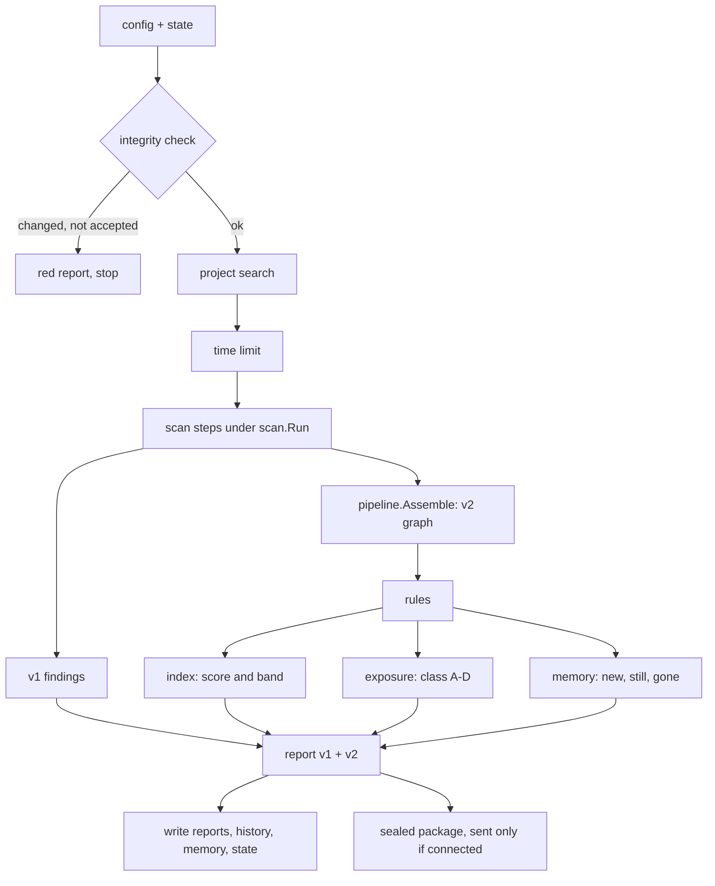

# Architecture

This page is a map of the RosmarOps code for someone who arrives with no context. It describes the code as it is. When this page and the code disagree, the code is right and this page needs a fix.

## What RosmarOps is

RosmarOps is a local security auditor for AI agents, written in Go.
It reads the configuration of the AI agents on the computer, the repositories and the local credential files. It only reads files at rest and never changes them.
From what it reads it builds a capability graph: which agent can do what, which keys it can reach, and which agent can change another.
Rules turn the graph into findings, and each evaluated agent gets a posture score out of 100.
The person-facing description is in [README.md](README.md). The promises the code must keep, and how to check them, are in [docs/trust-model.md](docs/trust-model.md).

## The flow of a review

`rosmarops run` and a double click both end in `runWith` in `cmd/rosmarops/cmd_run.go`. Its steps, in order:

1. On Linux, move `~/.rosmarops/reports/` to `~/RosmarOps/` once, when the person's configuration sets no `report_directory` and only the old folder exists (`cmd/rosmarops/reportsmove.go`, `report.MoveOldReports`). Then load the configuration (`internal/config`) and the state (`internal/state`). On a computer a company manages, the company configuration (`internal/company`) is read first; it is the configuration in use only when the person has none of their own. A missing state is replaced by a default one with a fresh salt, and the run says it cannot be compared.
2. Check integrity: the binary and the configuration against the references in the state. The person confirms a change in the console, a Microsoft Store update is accepted on its own, and anything else stops the run with a red report (`cmd/rosmarops/integrity.go`, `storeaccept.go`). The other commands (`status`, `findings`, `kit`, `connect` and the rest) run the same check before they start (`integrityCheck` in `cmd/rosmarops/main.go`), in the system's language.
3. Only now use the configured reports directory, and mark the review as in progress in the problem notebook (`internal/problems`).
4. Find the projects (`internal/scan/projects`) and compute the global time limit from their number (`scan.GlobalTimeoutFor`).
5. Run the scan steps one after another under that limit (`scan.Run`): `vscode`, `mcp`, `credentials`, `graph`, `shellprofile`, `scheduledtasks`, `avexclusions`, `globals`, `repos`. A step that panics or runs out of time is recorded as a scan error. The others still run.
6. The `graph` step reads every agent through the platform adapter and assembles the v2 graph (`pipeline.Assemble`). A graph that fails validation is not written.
7. Build the reports: the v1 report (`report.Build`) and the v2 report (`report.BuildV2`). The v2 report runs the rules (`internal/rules`), the score (`internal/index`), the exposure class (`internal/exposure`) and the memory of the previous run (`internal/memory`).
8. If this computer is connected to its space, seal the results package (`internal/results`) and send it (`internal/spacenet`).
9. Write the report files, the score history, the findings memory and the status line, then save the state.
10. Print the summary and open the report. With someone at a console and at least one new finding, one line says that `rosmarops findings` dismisses or accepts findings; `run` itself never asks.
11. After the report, the problem-report step, then the usage statistics step (`cmd/rosmarops/cmd_usage.go`): with someone at a console and no answer yet, ask once; with usage statistics on, build this review's `usage.v1` summary (`internal/usage`) and send it once (`internal/spacenet`). Neither step changes the report or the exit code.

On Windows a double click asks through RosmarOps's own windows after the report (connect, findings, problems), each a PowerShell WinForms process that talks to RosmarOps over its standard streams (`cmd/rosmarops/windowscripts.go`). No window can hold the run without a limit (`cmd/rosmarops/connectwindow.go`):
- a window nobody answers closes as «Not now»: the connect window after 10 minutes (`connectAnswerLimit`), the findings and problems windows after 15;
- once «Save to my space» is pressed, the connect window closes 21 minutes later at most (`connectPressedLimit`: the connection's own 11 minutes plus 10 to press OK on the result), and the connection's result stands;
- when RosmarOps is done with a window it closes the window's input, and the window closes too. The connect window now does this like the findings window. RosmarOps only closes the input after the window was answered or to end it, so a person never sees a window close under them;
- a window process that has not ended 10 seconds after its input is closed (`windowExitLimit`) is ended, and the run log says so.

With a window's self-test hook set (`ROSMAROPS_CONNECT_WINDOW_SELFTEST`, `ROSMAROPS_FINDINGS_WINDOW_SELFTEST`), which a person never sets, the real window opens and answers itself, and RosmarOps writes `window self-test: shown` with the window's name to the run's log. The journey tests on Windows use this (see [docs/how-to/journeys.md](docs/how-to/journeys.md) and [ADR 0021](docs/decisions/0021-journey-tests-before-publishing.md)).

## Layers and packages

The entry point is `cmd/rosmarops`. Data flows from the readers to the engine to the outputs. Every package of `internal/` is listed below.

### Entry

- `cmd/rosmarops`: the program. Command tree in `main.go`; one `cmd_*.go` file per command; the console, windows and prompts of each system.
- `internal/cli`: the command dispatcher on the standard `flag` package, with help texts from the catalog.

### Reading

- `adapters/windows`: the readers of every agent's files. Despite its name, macOS and Linux use them too (see Known oddities).
- `adapters/darwin`, `adapters/linux`: the macOS and Linux platforms. They call the readers of `adapters/windows` with their own folder layout.
- `internal/platform`: the `Platform` interface and the data types every reader returns.
- `internal/agentdirs`: the configuration folders of each agent on Windows, macOS and Linux.
- `internal/scan`: runs the scan steps under the global time limit.
- `internal/scan/avexclusions`: new Windows Defender exclusions since the baseline (v1).
- `internal/scan/configkeys`: configuration keys an agent reads differently from RosmarOps, as red findings.
- `internal/scan/credfiles`: `.env` files of each repository and a fixed list of the user's credential files.
- `internal/scan/deps`: empty (a `.gitkeep` only).
- `internal/scan/globals`: new global npm and pnpm packages and non-default registries (v1).
- `internal/scan/mcp`: where each MCP server's command lives (v1).
- `internal/scan/n8n`: an n8n user folder at rest.
- `internal/scan/projects`: the project search under the user's folder and the configured roots.
- `internal/scan/pyenv`: installed Python packages, from their folder names.
- `internal/scan/repos`: per-repository checks: git status, hooks and committed secrets.
- `internal/scan/scheduledtasks`: new Windows scheduled tasks since the baseline (v1).
- `internal/scan/secrets`: the secret patterns and the redacted preview.
- `internal/scan/shellprofile`: changes to the PowerShell profile (v1).
- `internal/scan/vscode`: new VS Code extensions (v1).
- `internal/scan/workflows`: empty (a `.gitkeep` only).
- `internal/skills`: the agent skills on disk (`SKILL.md` and scripts).
- `internal/firstrun`: finds the projects of a first use, or asks for the folder.
- `internal/company`: a managed computer's company configuration and administrator fingerprint list: their machine folder, the ownership check, and reading both files (see [docs/company.md](docs/company.md)).
- `internal/hostenv`: tells whether the review runs in a container, WSL, a virtual machine or Windows Sandbox.
- `internal/jsonc`, `internal/jsonkeys`, `internal/tomlsubset`, `internal/yamlsubset`: in-house readers for JSON with comments, JSON with exact keys, and the small parts of TOML and YAML the agents use.

### Engine

- `internal/pipeline`: assembles the v2 graph, the one way `rosmarops run` and the tests build it.
- `internal/graph`: the graph types, the per-agent graph builders, inference, crosses, and validation against the schema.
- `internal/rules`: turns the graph into v2 findings with their actions, and picks the one thing to do today.
- `internal/index`: the posture score, its bands and the score history.
- `internal/exposure`: the six exposure axes and the class A-D.
- `internal/knowledge`: documented product behaviour, dated and sourced, plus the MCP server catalog.
- `internal/finding`: the v1 `Finding` type and the status reducer.
- `internal/declared`: the questions about settings RosmarOps cannot read at rest (Cursor, Grok Bot), and their answers.
- `internal/profiles`: the Claude Code sandbox templates P0-P3 and their measured scores.
- `internal/agents`: the registry of scored products and their configuration sources.
- `internal/intel`: the embedded threat-data snapshot and the local cross against what was read.
- `internal/memory`: the findings memory between runs.

### Output

- `internal/report`: builds and writes the reports: Markdown, JSON, the v2 JSON, the HTML pages and the export for your AI. The HTML's first screen (`html_r3.go`) groups the findings by problem while it draws the page (`issues.go`): by the service a credential opens, and by the agent that can change other agents' settings. There is no field for it in `report.v2`: the groups are drawn from data the JSON already has, so the findings and their counts stay the same for every other reader. See [the decision](docs/decisions/0020-report-in-three-blocks.md).
- `internal/report` also exports the templates for the open repository `qtorb/rosmarops-templates` (`templates_export.go`): each template «Choose a template» offers, as the text the report copies, with a README made of the catalog's English texts that describe it. `tools/exporttemplates` writes them, with the Claude Code skill `skills/rosmarops-templates/SKILL.md`. Nothing in them comes from the computer that runs the export. See [how to export the templates](docs/how-to/export-the-templates.md).
- `internal/spacenet`: the only package that uses the network: HTTPS to `app.rosmarops.com`, only with permission.
- `internal/results`: the sealed results package for the space.
- `internal/kit`: the user's kit key, its file format and its storage on each computer.
- `internal/agenthooks`: RosmarOps inside Claude Code: the session check and the status line.
- `internal/notify`: the Windows notification after a scheduled review.
- `internal/problems`: the local problem notebook and the problem report.
- `internal/usage`: the usage statistics summary (`usage.v1`): `Build` keeps only fixed values and closed lists, and the result is checked against the schema before it is sent. See [docs/usage-statistics.md](docs/usage-statistics.md).

### Support

- `internal/catalog`: the message catalog; one JSON file per language in `internal/catalog/messages/`.
- `internal/config`: loads and validates `config.json`.
- `internal/state`: loads and saves `state.json` atomically.
- `internal/schemas`: the embedded copies of the JSON schemas in `schemas/`.
- `internal/schemaval`: the in-house JSON Schema validator.
- `internal/hash`: SHA-256 and HMAC-SHA256 helpers.
- `internal/untrusted`: makes text read from disk safe to show.
- `internal/proc`: starts child processes without a window.
- `internal/winpath`: trusted Windows system paths from the Windows API.
- `internal/winpkg`: the Microsoft Store package identity of the running process, and the checks on it: `IdentityIsOwn` (RosmarOps's own package, run from its own folder) and `Accepts` (a Store update the integrity check accepts). The usage statistics' channel `store` uses `IdentityIsOwn`.

## The graph

The contract is [schemas/v2/graph.v2.schema.json](schemas/v2/graph.v2.schema.json). The engine writes it to `graph.v2.json` in the reports data folder.

Node kinds:

- `agent`: `ai_client`, `mcp_server`, `extension`, `bot`, `orchestrator` (a program that starts other agents, such as Paperclip, Paseo, Claude Squad or Orca).
- `capability`: `execute_shell`, `read_files`, `write_files`, `network`, `invoke_mcp_tool`, `permission_mode`, `operate_app`.
- `credential`: `api_key`, `db_credential`, `oauth_token`, `webhook_secret`, `ssh_key`, `private_key`, `generic_secret`. A credential node has no field for the secret value. Most are identified by their value's salted fingerprint. A credential with `identified_by: path` is known by where it is, and its content is never read: it has a fingerprint of its normalized path (`path_fingerprint`, which does not change when the content changes) and its file's owner and permissions. Paperclip's `secrets/master.key`, `.env`, `llm.apiKey` and `database.connectionString` are of this kind.
- `resource`: `file`, `database`, `external_service`, `agent_config`, `agent_instructions`, `agent_executable`, `git_repository`, `inbound_channel`, `agent_schedule`, `agent_memory`.

Edge types: `has`, `reaches`, `writes_config_of`, `reads_config_of`, `loads`, `receives`, `authenticates_to`, `reads_env`, `committed_in`, `wakes`, `sends_to`, `launches`. `launches` goes from an orchestrator to an installed agent it can start: whether it skips that agent's approvals (`approval_override`), whether the agent gets its environment (`env_passthrough`), and where that comes from (`basis`). It is observed, with `basis: configured`, when the agent's mode is read in one of the orchestrator's own files (Paseo's agents and schedules, Claude Squad's `config.json` and `state.json`); its source is that file. Otherwise it is inferred from the product's defaults (`basis: product_default`): with `orchestrator_agent_configured` for Paperclip, which keeps its agents in its database, and with `orchestrator_settings_not_read` for Orca, which keeps its permission setting there. `wakes` is inferred when its source is a product default (`kb:`). Each node and edge has a certainty: `observed` (read in a file) or `inferred` (worked out from documented behaviour).

`pipeline.Assemble` builds the graph in this order:

1. `fragment`: the agent readers and merges. First the scans of Claude Code, Cursor, the credential files, the repositories, Hermes Agent, Codex and Grok Build. Then GitHub Copilot, Antigravity CLI, Gemini CLI and Cline. Then the shared instruction and skills files, the VS Code extensions, Grok Bot, and what can wake an agent without the person. Last, Paperclip (`graph.AddPaperclip`) and the other orchestrators (`graph.AddOrchestrators`: Paseo, Claude Squad, Orca): their `launches` and `writes_config_of` edges point at the agents, skills and configuration files already merged.
2. `BuildGraph`: build, mark the untrusted folders of Codex and Gemini CLI and the Claude Code mode under the VS Code extension, infer the `reaches` and `writes_config_of` edges, and cross with the threat data.
3. The MCP catalog cross and the n8n cross.
4. `graph.Encode`: validation against the schema and referential integrity. A graph that fails is never returned.

**The order inside `fragment` matters.** Every `ai_client` must be merged before `AddInstructions` and `AddSkills`, because those attach the shared files (`AGENTS.md`, a skills folder) only to the agents already in the fragment. A new agent merged after them silently misses its instructions and skills.

## Score, class and status

**Posture score** (`index.Compute` in `internal/index/index.go`). Each evaluated agent gets a score out of 100 inside the band of its worst v2 finding:

| Band | Worst finding | Range |
|---|---|---|
| `exposed` | red | 0-49 |
| `open_gaps` | yellow, no red | 50-79 |
| `contained` | none | 80-100 |

Inside the band, the score is `floor(span × K / (K + P))` above the band's floor, with `K = 80`. The span is 49, 29 or 20 points. `P` is the sum of the weights of the agent's findings plus the posture weight. `weightIn(version, finding)` gives the weight of each finding by rule, severity and credential class, ×1.5 when it reaches every project. Old index versions keep their weights, so two reports with different versions can still be compared. The current version is `index.Version`. The computer's score is the worst agent's, and only when every agent present has a score.

**Exposure class** (`classify` in `internal/exposure/exposure.go`). There are six axes: autonomy, reach, contagion, delegation, opacity and complexity. Each has a level from 0 to 3. Autonomy, reach and contagion weigh 2; the others weigh 1. `F = Σ weight × level / Σ weight × 3` over the axes with data. The class is A when F is below 0.25, B below 0.50, C below 0.75, and D otherwise. The class is `provisional` while an axis has no data. `AllowedClasses` says which classes are coherent with each band.

**Status** (`finding.Reducer` in `internal/finding/finding.go`). Any red finding gives red. Any scan error, or any yellow finding, gives yellow. Green needs no red or yellow finding and no scan error. The v2 report has its own reduction (`reduceV2`): a source that could not be read gives at least yellow, and no graph gives yellow. The report's status is the higher of the two.

## What is written to disk and where

Only these places receive writes (invariant 2 in [CLAUDE.md](CLAUDE.md)):

- `~/.rosmarops/state.json`: the state, written atomically.
- `~/.rosmarops/config.json`: created once by `init`, and rewritten only when the person dismisses or accepts findings.
- `~/.rosmarops/kit.dpapi` (Windows) or `~/.rosmarops/kit.key` (macOS, Linux): the kit key.
- The reports directory, `~/.rosmarops/reports/` (`~/RosmarOps/` on Linux) unless the configuration sets another:
  - `report.html` and `report.<lang>.html`: the visual report, one page per language;
  - `data/`: everything else. That is `report.md`, `report.json`, `report.v2.json`, the export for your AI, `graph.v2.json`, `index-history.json`, `findings-memory.json`, `config.accepted.json`, the run logs, `rosmarops-sends.log`, `rosmarops-problems.jsonl`, `rosmarops-usage-last.json` (the last usage summary sent or tried), `rosmarops-run.inprogress`, `statusline.txt`, the Claude Code session snapshots in `data/session/`, the sealed `rosmarops-results-*.locked.json` packages, and, on a computer a company manages with the summary on, `rosmarops-summary.json`;
  - `rosmarops-kit-<id>.json`: the exported kit file, when the person creates one.

`tests/trust/no_writes_out_of_scope_test.go` runs the program in a sandbox and fails if anything is written elsewhere.

## Tests that run the real program

- `tests/trust`: the invariants, mechanically (network, writes, secrets, integrity, and that what reaches the console comes from the catalog).
- `tests/integration`: the real binary on fixture computers.
- `tests/journeys` and `.github/workflows/journeys.yml`: the journey tests R1-R3, a candidate driven as a person would through a pseudo-terminal (ConPTY on Windows) on ubuntu-24.04 with Firefox as a snap, windows-latest (also through the MSIX test package) and macos-latest, with test computers built by `tests/journeys/makehome`. `release.yml` runs them between `build` and `publish`, on the same bytes; they block the publication once `JOURNEYS_GATE` is `on`. See [docs/how-to/journeys.md](docs/how-to/journeys.md) and [ADR 0021](docs/decisions/0021-journey-tests-before-publishing.md).

## Known oddities

- **`adapters/windows` is used on all three systems.** Its files have no build constraint. `adapters/darwin` and `adapters/linux` call its readers with their own folder layout (`internal/agentdirs`).
- **v1 and v2 live side by side.** The v2 graph and rules are the product. The v1 scanners `vscode`, `mcp`, `shellprofile`, `scheduledtasks`, `avexclusions`, `globals` and `repos` still run and still produce v1 findings. The v2 report keeps only the v1 findings that have not moved to v2. Each v1 scanner is removed when v2 replaces it, not before.
- **Two `Finding` types.** `finding.Finding` is v1. `rules.Finding` is v2.
- **Two meanings of "class".** A credential's class (`high`, `medium`, ... in `internal/rules`) sets the weight of its findings. An agent's exposure class (A-D in `internal/exposure`) describes how exposed it is.
- **`allow` and `schedule` are not built.** The commands exist and print «not implemented yet».
- **`internal/scan/deps` and `internal/scan/workflows` are empty folders.**
- **Where the configuration is looked up.** `rosmarops run` from a console reads `rosmarops.config.json` in the working folder if it exists, and `~/.rosmarops/config.json` otherwise. A scheduled review and a double click read only `~/.rosmarops/config.json`. Without either, on a computer a company manages, the company configuration is used in memory (see [docs/company.md](docs/company.md)).
- **Very long files.** These go over 1,400 lines: `internal/rules/overview.go`, `internal/rules/rules.go`, `internal/report/html.go`, `internal/platform/interface.go` and `cmd/rosmarops/cmd_run.go`. In the last one, `runWith` alone is about 1,050 lines.
